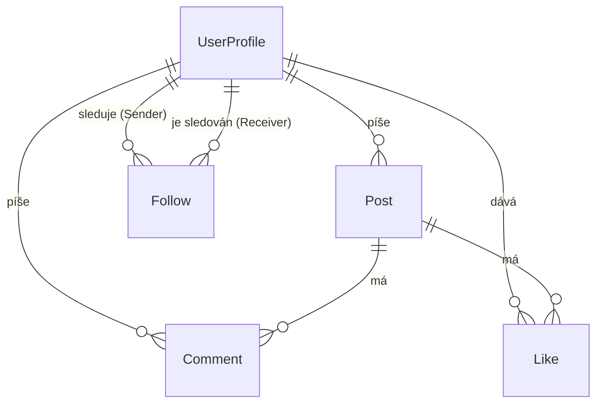

# SocialSite

Jednoduchá sociální síť: uživatelé sdílejí příspěvky, komentují, lajkují a sledují ostatní. Administrátor spravuje uživatele a obsah.

## Funkce

### Role

| Role | Popis |
|------|-------|
| **Návštěvník** | Nepřihlášený uživatel |
| **User** | Registrovaný uživatel |
| **Admin** | Správce aplikace |

### Co kdo může

| Akce | Návštěvník | User | Admin |
|------|:---:|:---:|:---:|
| Zobrazit landing page | ✅ | ✅ | ✅ |
| Registrace / přihlášení | ✅ | – | – |
| Upravit vlastní profil (jméno, profilová fotka, bio) | – | ✅ | ✅ |
| Vytvářet, upravovat a mazat vlastní příspěvky | – | ✅ | ✅ |
| Komentovat příspěvky a mazat vlastní komentáře | – | ✅ | ✅ |
| Lajkovat příspěvky | – | ✅ | ✅ |
| Sledovat (follow) ostatní uživatele | – | ✅ | ✅ |
| Přehled všech uživatelů, blokování a mazání účtů | – | – | ✅ |
| Upravovat a mazat jakékoli příspěvky a komentáře | – | – | ✅ |

> Admin nemůže měnit hash hesla uživatele.

## Datový model



| Entita | Atributy | Vztahy |
|--------|----------|--------|
| **UserProfile** | `Id`, `Name`, `DateOfBirth`, `Bio`, `ProfilePicturePath` | Posts 1:N, Comments 1:N, Likes 1:N |
| **Post** | `Id`, `Content`, `CreatedAt`, `UpdatedAt`, `ImagePath`, `UserProfileId` | Comments 1:N, Likes 1:N |
| **Comment** | `Id`, `Text`, `CreatedAt`, `PostId`, `UserProfileId` | Autor (UserProfile), Post |
| **Like** | `Id`, `CreatedAt`, `PostId`, `UserProfileId` | UserProfile, Post |
| **Follow** | `Id`, `SenderId`, `ReceiverId`, `CreatedAt` | Sender (UserProfile), Receiver (UserProfile) |

## Technické detaily

### Validace
- Serverová validace modelů a DTO
- Vlastní validační atributy:
  - **Ověření věku** podle `DateOfBirth`
  - **Slovník zakázaných slov** pro příspěvky a komentáře

### Upload souborů
- Nahrávání profilové fotky – uživatel i admin

### Logování
- [Serilog](https://serilog.net/) loguje kritické operace

### Testy
- Unit testy aplikačních služeb (např. `PostService`)
- Závislosti se v testech mockují

## Spuštění

```bash
# doplň: klonování, konfigurace, migrace, spuštění
```
