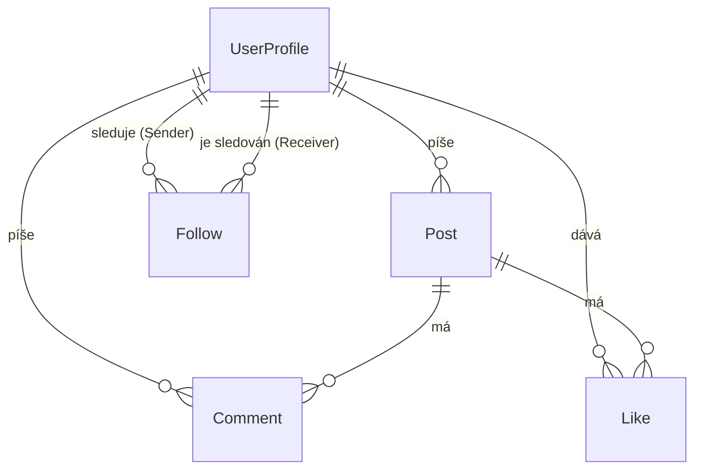

# SocialSite

Jednoduchá sociální síť: uživatelé sdílejí příspěvky, komentují, lajkují a sledují ostatní. Administrátor spravuje uživatele a obsah.

## Funkce

### Role

| Role | Popis |
|------|-------|
| **Návštěvník** | Nepřihlášený uživatel |
| **User** | Registrovaný uživatel |
| **Admin** | Správce aplikace |

### Co kdo může

| Akce | Návštěvník | User | Admin |
|------|:---:|:---:|:---:|
| Zobrazit landing page | ✅ | ✅ | ✅ |
| Registrace / přihlášení | ✅ | – | – |
| Upravit vlastní profil (jméno, profilová fotka, bio) | – | ✅ | ✅ |
| Vytvářet, upravovat a mazat vlastní příspěvky | – | ✅ | ✅ |
| Komentovat příspěvky a mazat vlastní komentáře | – | ✅ | ✅ |
| Lajkovat příspěvky | – | ✅ | ✅ |
| Sledovat (follow) ostatní uživatele | – | ✅ | ✅ |
| Přehled všech uživatelů, blokování a mazání účtů | – | – | ✅ |
| Upravovat a mazat jakékoli příspěvky a komentáře | – | – | ✅ |

> Admin nemůže měnit hash hesla uživatele.

## 🗄️ Datový model

Struktura databáze je navržena pro potřeby sociální sítě, kde uživatelé tvoří obsah a vzájemně interagují.

### ER Diagram


### 👤 UserProfile (Profil uživatele)

| Atribut | Datový typ | Omezení | Popis |
| :--- | :--- | :--- | :--- |
| `Id` | `UUID` / `Int` | Primary Key | Unikátní identifikátor profilu |
| `Name` | `String` | Not Null | Zobrazované jméno uživatele |
| `DateOfBirth`| `Date` | Not Null | Datum narození (slouží k validaci věku) |
| `Bio` | `String` | Nullable | Krátký popisek (informace o uživateli) |
| `ProfilePicturePath`| `String` | Nullable | Relativní cesta k nahrané profilové fotce |

### 📝 Post (Příspěvek)

| Atribut | Datový typ | Omezení | Popis |
| :--- | :--- | :--- | :--- |
| `Id` | `UUID` / `Int` | Primary Key | Unikátní identifikátor příspěvku |
| `Content` | `String` | Not Null | Textový obsah příspěvku (validováno na zakázaná slova) |
| `ImagePath` | `String` | Nullable | Relativní cesta k nahranému obrázku |
| `CreatedAt` | `DateTime` | Auto-generated| Datum a čas vytvoření |
| `UpdatedAt` | `DateTime` | Nullable | Datum a čas poslední úpravy |
| `UserProfileId`| `UUID` / `Int` | Foreign Key | Autor příspěvku |

### 💬 Comment (Komentář)

| Atribut | Datový typ | Omezení | Popis |
| :--- | :--- | :--- | :--- |
| `Id` | `UUID` / `Int` | Primary Key | Unikátní identifikátor komentáře |
| `Text` | `String` | Not Null | Obsah komentáře (validováno na zakázaná slova) |
| `CreatedAt` | `DateTime` | Auto-generated| Datum a čas vytvoření |
| `PostId` | `UUID` / `Int` | Foreign Key | Vazba na komentovaný příspěvek |
| `UserProfileId`| `UUID` / `Int` | Foreign Key | Autor komentáře |

### ❤️ Like (To se mi líbí)

| Atribut | Datový typ | Omezení | Popis |
| :--- | :--- | :--- | :--- |
| `Id` | `UUID` / `Int` | Primary Key | Unikátní identifikátor |
| `CreatedAt` | `DateTime` | Auto-generated| Datum a čas udělení lajku |
| `PostId` | `UUID` / `Int` | Foreign Key | Vazba na lajkovaný příspěvek |
| `UserProfileId`| `UUID` / `Int` | Foreign Key | Kdo dal lajk |

### 🤝 Follow (Sledování)

| Atribut | Datový typ | Omezení | Popis |
| :--- | :--- | :--- | :--- |
| `Id` | `UUID` / `Int` | Primary Key | Unikátní identifikátor |
| `SenderId` | `UUID` / `Int` | Foreign Key | Sledující uživatel (Kdo začal sledovat) |
| `ReceiverId` | `UUID` / `Int` | Foreign Key | Sledovaný uživatel (Kdo je sledován) |
| `CreatedAt` | `DateTime` | Auto-generated| Datum a čas začátku sledování |

## Technické detaily

### Validace
- Serverová validace modelů a DTO
- Vlastní validační atributy:
  - **Ověření věku** podle `DateOfBirth`
  - **Slovník zakázaných slov** pro příspěvky a komentáře

### Upload souborů
- Nahrávání profilové fotky – uživatel i admin

### Logování
- [Serilog](https://serilog.net/) loguje kritické operace

### Testy
- Unit testy aplikačních služeb (např. `PostService`)
- Závislosti se v testech mockují

## Spuštění

```bash
# doplň: klonování, konfigurace, migrace, spuštění
```
## 🚀 Jak spustit aplikaci

Před spuštěním aplikace se ujistěte, že máte nainstalované požadované prerekvizity a správně nakonfigurovanou databázi.

---

### 📋 Prerekvizity

* **.NET SDK** (verze 8.0 / 9.0) – [Stáhnout .NET](https://dotnet.microsoft.com/download)
* **Databázový server** (MS SQL Server / LocalDB / PostgreSQL / Docker container podle nastavení)
* **.NET EF Core CLI Tools** (pro správu databázových migrací):
  ```bash
  dotnet tool install --global dotnet-ef
  ```

---

### ⚙️ Konfigurace a příprava databáze

1. Otevřete soubor `appsettings.json` ve spouštěcím webovém projektu (např. `SocialSite.Web` nebo `SocialSite.API`).
2. Zkontrolujte nebo upravte **Connection String** na vaši databázi:
   ```json
   "ConnectionStrings": {
     "DefaultConnection": "Server=(localdb)\\mssqllocaldb;Database=SocialSiteDb;Trusted_Connection=True;MultipleActiveResultSets=true"
   }
   ```
3. Aplikujte databázové migrace (vytvoření databáze a tabulek):
   ```bash
   # Spusťte v kořenové složce projektu
   dotnet ef database update --project SocialSite.Infrastructure --startup-project SocialSite.Web
   ```
   *(Cesty k projektům přizpůsobte podle přesného názvu vašich vrstev v solution).*

---

### 🔨 První spuštění
    Jakmile dojde ke stažení zip souboru z gitu, nebo clone repozitáře. Jako první je za potřebí spustit následující command do konzole z výchozí složky:
    ```bash
    cd SocialSite.Web
    ```
    odtud pokračujte na spuštění aplikace


### 💻 Způsoby spuštění

#### Způsob 1: Pomocí .NET CLI (Příkazová řádka)
Nejrychlejší univerzální způsob pro jakýkoliv operační systém.

1. Otevřete terminál a přejděte do složky spouštěcího projektu:
   ```bash
   cd SocialSite.Web
   ```
2. Spusťte aplikaci:
   ```bash
   dotnet run
   ```
3. Pro automatické načítání změn v kódu za běhu (Hot Reload) použijte:
   ```bash
   dotnet watch run
   ```
Aplikace poběží na adrese zobrazené v konzoli (např. `https://localhost:7001` nebo `http://localhost:5000`).

---

#### Způsob 2: Pomocí Visual Studio (IDE)
1. Otevřete soubor řešení `SocialSite.sln` ve Visual Studiu.
2. V **Solution Exploreru** klikněte pravým tlačítkem na spouštěcí webový projekt (`SocialSite.Web` nebo `SocialSite.API`) a zvolte **Set as Startup Project**.
3. Stiskněte **F5** (spuštění s laděním/debuggingem) nebo **Ctrl + F5** (rychlé spuštění bez ladění).

---

#### Způsob 3: Pomocí Visual Studio Code / JetBrains Rider

* **Visual Studio Code:**
  1. Otevřete kořenovou složku v VS Code (`code .`).
  2. Otevřete integrovaný terminál (`Ctrl + ~`) a spusťte:
     ```bash
     dotnet run --project SocialSite.Web
     ```
  3. Případně v záložce **Run and Debug** (`Ctrl + Shift + D`) stiskněte **F5** pro spuštění přes připravený konfigurační soubor.

* **JetBrains Rider:**
  1. Otevřete soubor `SocialSite.sln`.
  2. V pravém horním rohu vyberte spouštěcí projekt z nabídky konfigurací.
  3. Klikněte na tlačítko **Run** (`Shift + F10`) nebo **Debug** (`Shift + F9`).

---

#### Způsob 4: Pomocí Dockeru / Docker Compose (Volitelné)
Pokud projekt obsahuje `Dockerfile` nebo `docker-compose.yml`:

1. V kořenové složce řešení spusťte:
   ```bash
   docker-compose up --build
   ```
2. Docker automaticky sestaví aplikaci, spustí databázový container a propojí je. Aplikace bude dostupná na nakonfigurovaném portu (např. `http://localhost:8080`).
